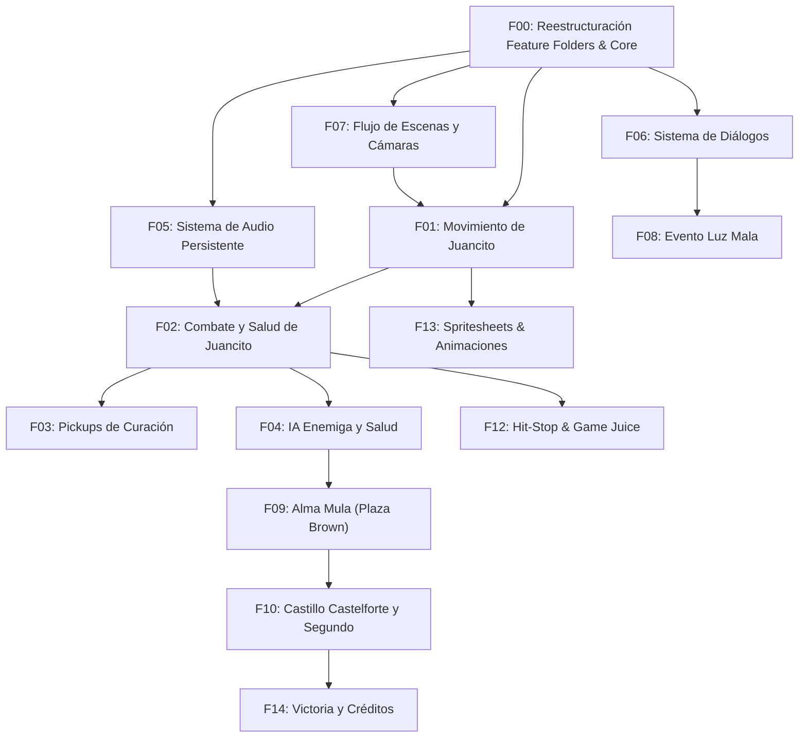

# Product Plan: Juancito de Adrogué

> Status: Approved

## Vision

*Juancito de Adrogué* es un videojuego de acción Beat 'em up y plataformas 2D que recrea los escenarios emblemáticos de la ciudad de Adrogué (Buenos Aires, Argentina) transformándolos en una aventura sobrenatural nocturna. A través de controles ágiles y combate cuerpo a cuerpo reactivo, el jugador encarna a Juancito en su regreso a casa, enfrentando leyendas del folclore argentino (Luz Mala, Alma Mula) y confrontando al gaucho Segundo en el histórico Castillo Castelforte para romper la maldición que asola la ciudad.

## Steering Context

- Product Steering: @.ai/steering/product.md
- Tech Stack Steering: @.ai/steering/tech-stack.md
- Conventions Steering: @.ai/steering/conventions.md
- Principles Steering: @.ai/steering/principles.md
- Ideas Capturadas: @.ai/sdd/ideas/001-vertical-slice-folders.md

## Personas

- **Jugador de Beat 'em Up Clásico:** Busca combates fluidos, respuestas rápidas de control, impacto claro de golpes y ritmo sostenido de avance.
- **Seguidor de la Cultura Local / Indie Argentino:** Valora la ambientación de Adrogué, el rescate de mitos populares y el humor característico presente en elementos cotidianos.

## MVP Boundary

### Must Have (Objetivo del MVP)

- Arquitectura de carpetas modular por Feature Folders (Vertical Slices) con `_Core/` compartido para desacoplar dependencias y aislar cambios.
- Control completo de Juancito (desplazamiento en plano 2D, orientación, ataque melee con cooldown y radio de impacto).
- Sistema de salud y daño reactivo (sacudida visual, flash de daño, barra de salud UI y secuencia de Game Over).
- Elementos curativos interactivos (recogida de Mate y Medialunas con restitución de salud).
- Enemigo básico funcional con IA de seguimiento, detección de distancia, recepción de daño y animación de muerte gradual.
- Transición de escenas entre Menú Principal y nivel jugable.
- Audio global persistente para música y efectos (`AudioManager`).
- Sistema de diálogos introductorios y de contexto con avance tipográfico (efecto máquina de escribir).

### Won't Have Yet (Post-MVP / Descartado)

- Personajes secundarios jugables (Gachi y Pachi descartados para enfocar todos los recursos en Juancito).
- Modos cooperativos o multijugador local/online.
- Mecánicas de inventario complejo o progresión con puntos de experiencia (RPG).

## Feature Map

### Phase 1 — MVP (Must Have: Núcleo Jugable y Base Arquitectónica)

| ID | Feature | Módulo / Ubicación Target | Descripción | Dependencias |
|----|---------|---------------------------|-------------|--------------|
| F00 | Reestructuración a Feature Folders y Shared Core | Arquitectura / `Assets/` | Migración de la estructura actual a `Assets/Features/` y `Assets/_Core/` preservando `.meta` y GUIDs. Establece las bases limpias para no generar dependencias acopladas. | Ninguna |
| F01 | Control y Movimiento de Juancito | `Assets/Features/Player/` | Movimiento en 2D con Rigidbody2D, lectura con Input System (WASD/flechas), normalización y volteo de orientación. | F00 |
| F02 | Sistema de Combate Melee y Salud de Juancito | `Assets/Features/Player/` | Ataque melee (tecla E) con `OverlapCircleAll`, efecto visual de golpe, barra de salud UI, daño reactivo por contacto y Game Over. | F00, F01 |
| F03 | Pickups Curativos (Mate y Medialuna) | `Assets/Features/Pickups/` | Detección de contacto con tag `Player`, restauración de puntos de salud en `SaludJugador` y autodestrucción del pickup. | F00, F02 |
| F04 | IA de Enemigo Básico y Sistema de Salud/Muerte | `Assets/Features/Enemies/` | Detección y persecución hacia Juancito (`Vector2.MoveTowards`), recepción de daño, efecto tambaleo/flash rojo y desvanecimiento alfa al morir. | F00, F02 |
| F05 | Sistema de Audio Persistente | `Assets/_Core/Audio/` | `AudioManager` Singleton persistente con `AudioMixer` (`Master`, `Musica`, `SFX`), persistencia entre escenas y disparadores de audio. | F00 |
| F06 | Sistema de Diálogos y Textos | `Assets/Features/Dialogue/` | Diálogos tipográficos con TextMeshPro, control de caracteres por segundo, opción de aceleración/salteo y evento de finalización. | F00 |
| F07 | Flujo de Escenas, Cámaras y Menú | `Assets/_Core/SceneManagement/` & `Camera/` | Control de escenas (`MainMenu`, `Nivel_01`), pantalla de carga/fade y cámaras cinemachine/zonas de combate. | F00 |

### Phase 2 — Essentials (Should Have: Encuentros y Progresión Sobrenatural)

| ID | Feature | Módulo / Ubicación Target | Descripción | Dependencias |
|----|---------|---------------------------|-------------|--------------|
| F08 | Evento Luz Mala frente a Casa de la Cultura | `Assets/Features/Levels/CasaCultura/` | Aparición fugaz de la Luz Mala con alteración de iluminación y tensión narrativa previa al combate. | F06, F07 |
| F09 | Enfrentamiento Alma Mula en Plaza Brown | `Assets/Features/Enemies/AlmaMula/` | Mini-jefe en Plaza Almirante Brown con mayor resistencia, patrones de embestida y arena delimitada. | F04, F07 |
| F10 | Castillo Castelforte y Jefe Final Segundo | `Assets/Features/Enemies/Segundo/` | Tramo final en Castelforte y enfrentamiento contra Segundo (antiguo gaucho), con fases de ataque y conclusión. | F04, F09 |
| F11 | Interfaz Diegética y Cartelería Local | `Assets/Features/Narrative/` | Noticias integradas de medios locales (Brown On-Line, Diario Sur) que relatan los sucesos paranormales en el entorno. | F06 |

### Phase 3 — Nice to Have (Could Have: Pulido y Game Feel)

| ID | Feature | Módulo / Ubicación Target | Descripción | Dependencias |
|----|---------|---------------------------|-------------|--------------|
| F12 | Hit-Stop y Sacudida de Pantalla Avanzada | `Assets/Features/CombatJuice/` | Micro-pausa temporal al conectar golpes críticos y retroalimentación mediante Cinemachine Impulse. | F02, F07 |
| F13 | Integración Completa de Spritesheets y Animaciones | `Assets/Features/Player/Animations/` | Vinculación del Animator Controller con los archivos `.ase` de Juancito (idle, walk, punch, hurt) y estados limpios. | F01, F02 |
| F14 | Secuencia Final y Pantalla de Victoria | `Assets/Features/EndGame/` | Pantalla de cierre de la aventura con regreso a casa y créditos del equipo de desarrollo. | F10 |

## Dependencies

## Risks

| Riesgo | Impacto | Mitigación |
|--------|---------|------------|
| Pérdida de GUIDs y metadatos `.meta` al mover carpetas | Crítico | Realizar las reubicaciones de archivos manteniendo sincronizados los pares de `.meta` y verificar en Unity Editor que ningún Prefab o Escena presente `Missing Script` o enlaces rotos. |
| Acoplamiento no intencional entre features | Medio | Definir reglas claras en `conventions.md`: las features pueden consumir `_Core/`, pero no deben depender directamente de scripts internos de otra feature sin pasar por interfaces o eventos. |
| Dispersión visual antes de consolidar el combate | Alto | Priorizar el MVP (Fase 1) asegurando que el combate cuerpo a cuerpo se sienta responsivo y divertido antes de detallar múltiples niveles. |

## Open Decisions

- **D-01 (Migración de archivos):** ¿Se ejecutará el movimiento de carpetas y metadatos con el editor de Unity abierto (para que Unity regenere/actualice rutas en el Library automáticamente) o mediante script de Powershell asegurando preservar cada `.meta`? (Recomendado: mover pares `.cs` + `.cs.meta` en repositorio y abrir Unity para validar).
- **D-02 (Salto de Juancito):** ¿El salto debe incluir detección de plataformas elevadas o mantenerse como un salto de esquive en el plano 2D? (Recomendado: esquive de golpes bajos/obstáculos).
- **D-03 (Transición Plaza Brown - Castelforte):** ¿Será continua por scroll o por cambio de escena clásico? (Actualmente existen escenas separadas en Unity).

## Next Step

Revisar y validar este plan de producto para promoverlo de borrador (`plan:draft`) a aprobado (`plan:approved`). Una vez aprobado, el primer feature a especificar en requisitos (`/sdd-prd`) será **`001-reestructuracion-feature-folders`** (F00).
