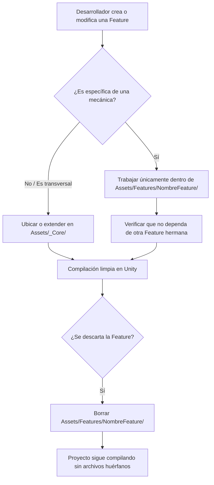

# Design: Reestructuración a Feature Folders (Vertical Slices) y Shared Core

> Requirements: @requirements.md
> Status: Approved

## 1. Summary

Este diseño técnico especifica la reestructuración completa de los assets y scripts del proyecto *Juancito de Adrogué* en Unity 6 (`6000.5.9f1`). Se migra desde una arquitectura horizontal técnica ("Package by Layer") a una arquitectura vertical modular por características (**Feature Folders / Vertical Slices**) respaldada por un núcleo compartido (**Shared Core** en `Assets/_Core/`).

La migración se ejecutará de forma atómica (Decisión D-003) mediante un procedimiento controlado de traslado en pares (`<archivo>` + `<archivo>.meta`), preservando el 100% de los GUIDs de Unity y evitando dependencias circulares entre features.

## 2. Requirements Mapping

| Requisito | Cobertura en Diseño |
|-----------|---------------------|
| **FR-001** (Jerarquía Raíz Estandarizada) | Sección 4: Estructura de carpetas bajo `Assets/Features/` y `Assets/_Core/`. |
| **FR-002** (Encapsulamiento del Player) | Sección 4: `Assets/Features/Player/` agrupando scripts, prefabs, animaciones, sprites Aseprite y audio local. |
| **FR-003** (Centralización de Core) | Sección 4: `Assets/_Core/` subdividido en `Audio/`, `Camera/` y `SceneManagement/`. |
| **FR-004** (Modularización de Enemigos, Pickups, Diálogos) | Sección 4: `Assets/Features/Enemies/`, `Assets/Features/Pickups/`, `Assets/Features/Dialogue/`. |
| **FR-005** (Preservación de Metadatos `.meta`) | Sección 12 y 15: Protocolo de movimiento en pares atómicos y validación de GUIDs. |
| **NFR-001** (Mantenibilidad y Desacople) | Sección 6 y 13 (TD-001, TD-002): Regla de dependencia unidireccional `Features -> Core`. |
| **NFR-002** (Compilación sin Errores) | Sección 15: Verificación de compilación de `Assembly-CSharp.csproj`. |
| **NFR-003** (Compatibilidad de Arte Genérico) | Sección 4 y 13 (TD-003): Conservación de fondos y tilesets en `Assets/Environment/` (o `Arte/Environment/`). |

## 3. Technical Approach

El enfoque técnico se basa en la separación estricta de responsabilidades a nivel del sistema de archivos de Unity:
1. **Vertical Slices (`Assets/Features/<Feature>/`):** Cada slice contiene la totalidad de los componentes necesarios para su funcionamiento (código C#, prefabs, animaciones Aseprite y clips de audio característicos). Si una feature deja de ser necesaria, borrar su carpeta raíz remueve el 100% de sus dependencias sin dejar residuos.
2. **Shared Core (`Assets/_Core/`):** Contiene componentes transversales que proveen infraestructura a múltiples features (gestión de volumen y música global, transiciones de pantalla, directores de cámara cinemachine).
3. **Regla de Dependencia:** `Features` pueden consultar `_Core`. Las `Features` NO deben referenciar directamente componentes internos de otras `Features`; la comunicación entre ellas ocurre mediante eventos Unity (`UnityEvent`), mensajes estándar o interfaces en `_Core`.

## 4. Component / Module Structure

```text
Assets/
├── _Core/
│   ├── Audio/
│   │   ├── AudioManager.cs (+ .meta)
│   │   ├── AudioSourceTrigger.cs (+ .meta)
│   │   ├── Mixers/ (+ .meta)
│   │   └── Ambiente/ (+ .meta)
│   ├── Camera/
│   │   ├── DirectorCamaras.cs (+ .meta)
│   │   ├── ZonaCombate.cs (+ .meta)
│   │   └── BloqueoZonaCombate.cs (+ .meta)
│   └── SceneManagement/
│       ├── AdministradorEscenas.cs (+ .meta)
│       ├── TransicionEscena.cs (+ .meta)
│       └── TransicionFade.cs (+ .meta)
│
├── Features/
│   ├── Player/
│   │   ├── Scripts/
│   │   │   ├── MOVIMIENTO.cs (+ .meta)
│   │   │   ├── CombateJugador.cs (+ .meta)
│   │   │   ├── SaludJugador.cs (+ .meta)
│   │   │   └── AnimacionJugador.cs (+ .meta)
│   │   ├── Prefabs/
│   │   │   └── Juancito.prefab (+ .meta)
│   │   ├── Animations/
│   │   │   └── *.anim (+ .meta) (Player_Idle, Player_Golpe_*)
│   │   ├── Sprites/
│   │   │   └── *.ase / *.aseprite (+ .meta) (provenientes de Assets/Juancito y Assets/Arte)
│   │   └── Audio/
│   │       ├── muertejuancito.mp3 (+ .meta)
│   │       ├── pasos.mp3 (+ .meta)
│   │       └── Sonido Golpe*.mp3 (+ .meta)
│   │
│   ├── Enemies/
│   │   ├── Scripts/
│   │   │   ├── EnemigoBasico.cs (+ .meta)
│   │   │   └── SaludEnemigo.cs (+ .meta)
│   │   ├── Sprites/
│   │   │   └── AlmaMula.ase, Gaucho.ase, etc. (+ .meta)
│   │   └── Audio/
│   │       └── Gruñidos.mp3 (+ .meta)
│   │
│   ├── Pickups/
│   │   ├── Scripts/
│   │   │   └── CurativoPickup.cs (+ .meta)
│   │   └── Sprites/
│   │       └── Mate.ase, Media luna.ase (+ .meta)
│   │
│   └── Dialogue/
│       └── Scripts/
│           └── Dialogo.cs (+ .meta)
│
├── Environment/ (o Arte/Environment/)
│   └── Sprites de escenarios (Estación, Castillo, Fondos, Calles)
│
└── Scenes/
    └── *.unity (+ .meta) (MainMenu, Nivel_01, Exterior, etc.)
```

## 5. Data Model / State

No aplicable (la feature no altera esquemas de datos serializados, ScriptableObjects ni estructuras de almacenamiento).

## 6. API / Integration Contract

- **Llamadas a Core:** Los scripts de features invocan a `AudioManager.Instance` y a `AdministradorEscenas` mediante sus patrones de Singleton ya existentes.
- **Interacción Player - Pickups:** `CurativoPickup` detecta colisión con el tag `Player` y consulta el componente `SaludJugador` adosado al GameObject.
- **Interacción Combate - Salud:** `CombateJugador` usa `OverlapCircleAll` contra `LayerMask` de enemigos e invoca `RecibirDano(float)` en `SaludEnemigo`.
- **Interacción Diálogos:** `Dialogo` emite un evento `dialogoFinalizado` (`UnityEvent`) desacoplado de la escena.

## 7. Security / Permissions / Privacy

No aplicable (entorno de ejecución cliente local standalone).

## 8. User Flows (Flujo de Desarrollo)



## 9. Edge Cases

| Caso | Comportamiento Esperado |
|------|-------------------------|
| Archivo `.meta` huérfano (sin archivo original) | El script de migración debe verificar y reportar cualquier `.meta` huérfano antes y después del traslado. |
| Archivo sin `.meta` previo | Si se mueve un archivo sin `.meta`, Unity regeneraría el GUID rompiendo enlaces. Se debe verificar que todo archivo conserve su `.meta` idéntico. |
| Referencias en escenas/prefabs con rutas relativas | Unity no referencia assets por ruta de archivo, sino exclusivamente por el GUID contenido en el `.meta`. Mientras el par archivo+`.meta` se mantenga, Unity actualiza las rutas transparentemente. |
| Nombres con caracteres especiales / acentos (ej. `Gruñidos.mp3`, `Estación Asiento.ase`) | El script de migración en PowerShell debe manejar codificación UTF-8 / nombres literales sin corromper caracteres. |

## 10. Accessibility / UX Notes

- No aplicable directamente a UI del jugador.
- A nivel DX (Developer Experience): la ventana Project en Unity queda desahogada, jerárquica y legible a primera vista.

## 11. Observability / Operations

- Registro de ejecución: el script de migración listará cada par de archivos movido `[OK] Origen -> Destino`.
- Git Diff: `git status` debe reflejar operaciones de `renamed` limpias en lugar de `deleted` + `untracked`.

## 12. Migration / Rollout

### Procedimiento Atómico de Migración:
1. **Creación de directorios target:** Crear la estructura de carpetas en `Assets/_Core/` y `Assets/Features/`.
2. **Traslado en pares (Script PowerShell):**
   - Mover cada asset junto a su archivo `.meta`.
   - Ejemplo: `Move-Item -LiteralPath "Assets/Scripts/MOVIMIENTO.cs" "Assets/Features/Player/Scripts/MOVIMIENTO.cs"` y `Move-Item -LiteralPath "Assets/Scripts/MOVIMIENTO.cs.meta" "Assets/Features/Player/Scripts/MOVIMIENTO.cs.meta"`.
3. **Limpieza de carpetas obsoletas vacías:**
   - Remover `Assets/Juancito` y `Assets/Juancito.meta` una vez vacía.
   - Remover subcarpetas vacías en `Assets/Scripts/`.
4. **Verificación de integridad:**
   - Validar que no existan `.meta` sin archivo.
   - Validar compilación C# en `Assembly-CSharp.csproj`.

## 13. Technical Decisions

### TD-001: Agrupación Vertical Slices vs Subcarpetas Clásicas
- **Decisión:** Agrupar scripts, prefabs, animaciones y audio local dentro de la carpeta de la feature (`Assets/Features/Player/`).
- **Por qué:** Permite la máxima modularidad; eliminar al Player o a un Enemigo elimina todos sus recursos dependientes en un único borrado.
- **Compromiso:** Los assets visuales del jugador ya no están en una única carpeta global `Assets/Arte/`, sino integrados en su slice.
- **Alternativas consideradas:** Agrupar solo scripts en features y dejar arte global (descartada en PRD porque no resuelve el problema de los assets huérfanos).

### TD-002: Conservación de _Core sin Ensamblado (.asmdef)
- **Decisión:** Mantener todo bajo `Assembly-CSharp` sin `.asmdef` en esta etapa.
- **Por qué:** Evita fricción y reescritura de visibilidad (`internal`/`public`) durante la reestructuración física.
- **Compromiso:** La regla de desacople `Features -> Core` se respeta por convención y revisión, no por restricción forzada del compilador.
- **Alternativas consideradas:** Introducir `.asmdef` inmediato (descartado por riesgo de dependencias circulares preexistentes).

### TD-003: Manejo de Entornos y Escenarios
- **Decisión:** Mover los assets de escenarios y estaciones (actualmente en `Assets/Assets/` y `Assets/Arte/EstacionTren*.ase`) a `Assets/Environment/` (o `Assets/Arte/Environment/`).
- **Por qué:** Los escenarios son compartidos por múltiples escenas y niveles; no pertenecen a un slice de mecánica individual.

## 14. Risks

| Riesgo | Impacto | Mitigación |
|--------|---------|------------|
| Pérdida de GUIDs y metadatos `.meta` | Crítico | Mover simultáneamente archivos y `.meta` con paths literales. Comprobar que `git status` muestre `renamed`. |
| Conflictos de caracteres UTF-8 en nombres de archivo (ñ, acentos) | Medio | Usar `-LiteralPath` en PowerShell para evitar que comodines o codificaciones interpreten erróneamente tildes o eñes. |
| Errores de compilación por namespaces cambiados | Bajo | Ningún namespace cambiará en este paso; C# en Unity resuelve clases en `Assembly-CSharp` sin importar la carpeta en la que residan. |

## 15. Verification Strategy

1. **Verificación de Metadatos:**
   - Script automatizado que verifique que cada archivo en `Assets/Features` y `Assets/_Core` tenga su `.meta`, y que no quede ningún `.meta` huérfano.
2. **Verificación de Git:**
   - Ejecutar `git status` y comprobar que Git reconozca la mayoría de los traslados como `renamed` o pares exactos.
3. **Verificación de Compilación C#:**
   - Ejecutar `dotnet build Assembly-CSharp.csproj` (o verificación sintáctica de Roslyn) para confirmar 0 errores de compilación (`CSxxxx`).
4. **Verificación de Integridad de Prefabs:**
   - Inspeccionar el archivo YAML `Assets/Features/Player/Prefabs/Juancito.prefab` para confirmar que las referencias GUID a los scripts `Movimiento2D`, `CombateJugador`, etc., siguen coincidiendo exactamente con los GUIDs en sus archivos `.cs.meta`.

## 16. Implementation FAQ

**P: ¿Qué pasa si abro Unity después de la migración?**  
**R:** Unity leerá los `.meta` reubicados, preservará todos los enlaces de componentes, actualizará su caché interna de `Library/` y ningún objeto en escena perderá sus scripts ni configuraciones.

**P: ¿Qué se hace con el archivo `NewEmptyCSharpScript.cs`?**  
**R:** Al ser un archivo generado por defecto sin referencias en escenas ni prefabs, se eliminará junto con su `.meta` para mantener limpio el repositorio.

**P: ¿Afecta esto a la configuración del proyecto o paquetes de Unity?**  
**R:** No, `ProjectSettings/`, `Packages/manifest.json` y la configuración de URP se mantienen completamente intactos.

