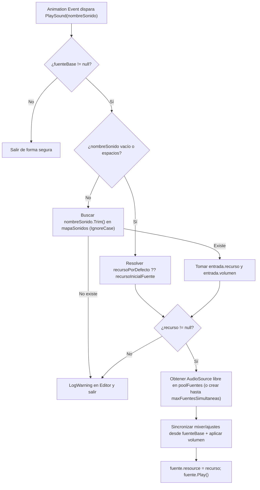

# Design: Disparador de Audio Multisonido en `AudioSourceTrigger`

> Requirements: @requirements.md
> Status: Approved

## 1. Summary

Extensión modular del componente `AudioSourceTrigger` en Unity 6 (`6000.5.9f1`) para permitir que un mismo GameObject (`Juancito`) reproduzca múltiples recursos de audio (`UnityEngine.Audio.AudioResource`, compatible tanto con `AudioRandomContainer` como con `AudioClip`) identificados por clave desde eventos de animación `PlaySound`.

Para lograr superposición sonora sin cortes (`FR-004`) respetando que `AudioRandomContainer` no soporta `PlayOneShot(AudioClip)`, el componente gestionará un mini-pool acotado de `AudioSource` bajo demanda clonando la configuración acústica y el `OutputAudioMixerGroup` del `AudioSource` base de `Juancito`.

## 2. Requirements Mapping

| Requirement | Design Coverage |
|-------------|-----------------|
| **FR-001** (Catálogo en Inspector) | Sección 5 (`EntradaSonido`, lista serializada `sonidos`) y `TD-001` (`AudioResource`). |
| **FR-002** (Selección por clave en `PlaySound`) | Sección 3, Sección 6 (`PlaySound(string)`) y `TD-002` (normalización `Trim` + `OrdinalIgnoreCase`). |
| **FR-003** (Fallback para `PlaySound` vacío) | Sección 5 (`recursoPorDefecto` + `recursoInicialFuente` cacheado en `Awake()`) y Sección 8. |
| **FR-004** (Superposición heredando `AudioSource` base) | Sección 3, Sección 5 (`poolFuentes`, `maxFuentesSimultaneas`) y `TD-003`. |
| **FR-005** (Manejo seguro de claves/nulos) | Sección 9 (Edge Cases) y validaciones explícitas con `Debug.LogWarning` en Editor/Development Build. |
| **NFR-001** (Usabilidad en Inspector) | Sección 5 y 10 (`[Header]`, `[Tooltip]`, `[Range]` en español según `conventions.md`). |
| **NFR-002** (Control de instancias / rendimiento) | Sección 5 y `TD-003`: límite estricto `maxFuentesSimultaneas` (por defecto `4`) y diccionario en memoria. |
| **NFR-003** (Integridad de `.meta` y clase) | Sección 4 y 12: modificación in-place del archivo `AudioSourceTrigger.cs` conservando su `.meta` (`221b63f03b983bf48b39758f3672b7c6`). |

## 3. Technical Approach

1. **Unificación con `AudioResource` (Unity 6):** Cada entrada del catálogo almacena un `UnityEngine.Audio.AudioResource` junto con su `id` (`string`) y una escala de volumen opcional (`[Range(0f, 1.5f)] float volumen = 1f`). Esto admite de forma nativa tanto `AudioRandomContainer` (ej. `Player_Golpes.asset` y el futuro contenedor de pasos) como `AudioClip` tradicionales.
2. **Búsqueda `O(1)` insensible a mayúsculas/espacios:** En `Awake()` (y reconstruible en `OnValidate()` en Editor) se indexan las entradas en un `Dictionary<string, EntradaSonido>` con `StringComparer.OrdinalIgnoreCase` aplicando `.Trim()` a cada clave.
3. **Firma única `PlaySound(string nombreSonido = "")` para Animation Events:** Se mantiene un único método llamado `PlaySound` con parámetro `string` opcional. Así:
   - En la ventana Animation de Unity aparece `PlaySound ( string )` habilitando el campo `String` para escribir `"pasos"` o `"golpes"`.
   - Los clips existentes (`Player_Golpe_01.anim`, `Player_Golpe_02.anim`) que invocan `PlaySound` con `data: ""` siguen funcionando sin editarse, cayendo en el recurso por defecto.
   - Se evita el conocido problema de sobrecarga de métodos en `MonoBehaviour` con `AnimationEvent`/`SendMessage`.
4. **Polifonía acotada heredando el `AudioSource` de `Juancito`:** Dado que en Unity 6 `AudioSource.PlayOneShot` solo acepta `AudioClip` y no `AudioResource`, `AudioSourceTrigger` utiliza el `AudioSource` existente de `Juancito` cuando está libre (`!isPlaying`) y, si está ocupado reproduciendo otro contenedor, reutiliza o crea hasta `maxFuentesSimultaneas` (por defecto `4`) fuentes auxiliares en el mismo GameObject copiando los parámetros del `AudioSource` base (`outputAudioMixerGroup`, `spatialBlend`, `pitch`, `volume`, curvas 2D/3D, etc.).

## 4. Component / Module Structure

```text
Assets/Scripts/Audio/                  (o Assets/_Core/Audio/ tras ejecutar spec 001)
└── AudioSourceTrigger.cs              # MonoBehaviour en Juancito
    └── struct EntradaSonido           # [Serializable] { string id, AudioResource recurso, float volumen }
```

## 5. Data Model / State

### Datos Serializados (Inspector)
- `recursoPorDefecto` (`AudioResource`, opcional): Recurso a reproducir cuando `PlaySound` llega sin clave. Si se deja nulo, se usa el `AudioResource` que tenía asignado originalmente el `AudioSource` de `Juancito` al iniciar (`recursoInicialFuente`).
- `sonidos` (`List<EntradaSonido>`): Lista configurable de entradas:
  - `id` (`string`): Identificador del sonido (ej. `"golpes"`, `"pasos"`).
  - `recurso` (`AudioResource`): Contenedor aleatorio o clip de audio.
  - `volumen` (`float`, rango `0f..1.5f`, default `1f`): Multiplicador relativo sobre el volumen del `AudioSource` base.
- `maxFuentesSimultaneas` (`int`, rango `1..8`, default `4`): Tope máximo de `AudioSource` en el pool local del GameObject para superponer sonidos sin cortes.

### Estado en Tiempo de Ejecución (Privado)
- `fuenteBase` (`AudioSource`): Referencia al `AudioSource` original de `Juancito`.
- `recursoInicialFuente` (`AudioResource`): Captura de `fuenteBase.resource` en `Awake()` para que nunca se pierda el sonido original de `Juancito` al alternar contenedores en `fuenteBase`.
- `mapaSonidos` (`Dictionary<string, EntradaSonido>`): Índice normalizado por clave.
- `poolFuentes` (`List<AudioSource>`): Lista acotada donde `poolFuentes[0]` es `fuenteBase` y `poolFuentes[1..N-1]` son canales auxiliares bajo demanda (`HideFlags.DontSave`).
- `indiceReemplazo` (`int`): Cursor circular para reutilizar una fuente existente si las `maxFuentesSimultaneas` están ocupadas simultáneamente.

## 6. API / Integration Contract

```csharp
[RequireComponent(typeof(AudioSource))]
public class AudioSourceTrigger : MonoBehaviour
{
    // Invocado por Animation Events (con String vacío o con clave ej. "pasos" / "golpes") y desde C#
    public void PlaySound(string nombreSonido = "");

    // Método auxiliar explícito sin parámetros por si se vincula desde un UnityEvent en Inspector
    public void PlayDefaultSound();
}
```

## 7. Security / Permissions / Privacy

Not applicable (componente local de audio en cliente standalone).

## 8. User Flows



## 9. Edge Cases

| Case | Expected Behavior |
|------|-------------------|
| `Player_Golpe_01.anim` / `Player_Golpe_02.anim` llaman `PlaySound` con `data: ""` | `string.IsNullOrWhiteSpace(nombreSonido)` es `true` → reproduce `recursoPorDefecto` o `recursoInicialFuente` (`Player_Golpes.asset`) sin romper nada, incluso si `fuenteBase.resource` cambió antes a `"pasos"`. |
| Error de mayúsculas o espacios en Animation Event (ej. `" Pasos "`, `"PASOS"`) | Se normaliza con `.Trim()` y `StringComparer.OrdinalIgnoreCase` → coincide con `"pasos"`. |
| Clave inexistente en `PlaySound("salto")` o entrada con `recurso == null` | No lanza excepción (`P-005`); emite `Debug.LogWarning` contextualizado al GameObject (solo en Editor / Development Build) y omite la reproducción. |
| Claves duplicadas en el Inspector | Se conserva la última/primera entrada válida de forma determinista y se avisa con `Debug.LogWarning` para facilitar su corrección en el Inspector. |
| Más de `maxFuentesSimultaneas` sonidos disparados al mismo tiempo | No crea nuevos `AudioSource`; recicla en *round-robin* una fuente del pool acotado cumpliendo `NFR-002`. |
| Nueva entrada `EntradaSonido` agregada en el Inspector de Unity (donde `float` inicia en `0` por defecto en structs) | Se usa una clase `[Serializable]` (`class EntradaSonido`) con inicializador `volumen = 1f` para que Unity serialice `1f` por defecto al agregar un elemento con `+` en la lista del Inspector. |

## 10. Accessibility / UX Notes

- **Experiencia en Inspector (DX):** Uso de `class EntradaSonido` serializable para que al pulsar `+` en la lista `Sonidos` en Unity el multiplicador `volumen` nazca en `1f` (y no en `0f`, evitando el clásico error de sonidos mudos al crear entradas nuevas en listas de structs en Unity).

## 11. Observability / Operations

- Advertencias en consola de Unity (`#if UNITY_EDITOR || DEVELOPMENT_BUILD`) indicando el nombre del `GameObject` y la clave faltante/duplicada pasando `this` como contexto para hacer clic en el mensaje y resaltar a `Juancito` en la jerarquía.

## 12. Migration / Rollout

- **Compatibilidad inmediata:** Al actualizar `AudioSourceTrigger.cs`, las escenas existentes (`Nivel_01`) mantienen su componente gracias a la preservación del `.meta` y `Juancito` sigue reproduciendo `Player_Golpes.asset` sin requerir tocar los clips actuales.
- **Convivencia con spec `001`:** Si `AudioSourceTrigger.cs` aún reside en `Assets/Scripts/Audio/` al ejecutar `tasks.md`, se edita allí; si la migración `001` ya lo movió a `Assets/_Core/Audio/`, se edita en esa ruta preservando el mismo GUID.

## 13. Technical Decisions

### TD-001: Uso de `UnityEngine.Audio.AudioResource` en lugar de `AudioClip`
- **Decision:** Tipar los recursos de sonido como `AudioResource`.
- **Why:** En Unity 6, los contenedores de golpes y pasos (`AudioRandomContainer`) heredan de `AudioResource` y no de `AudioClip`. Usar `AudioResource` soporta ambos tipos transparentemente en el mismo campo del Inspector.
- **Trade-off:** No se puede usar `AudioSource.PlayOneShot(AudioClip)` directamente para contenedores.
- **Alternatives considered:** Usar `AudioClip[]` y programar aleatoriedad manual en C# (descartado porque desaprovecha los `AudioRandomContainer` que el proyecto ya usa en `Player_Golpes.asset`).

### TD-002: Firma Única `PlaySound(string nombreSonido = "")` sin Sobrecarga `PlaySound()`
- **Decision:** Exponer un único método llamado `PlaySound` que recibe `string nombreSonido = ""` y ofrecer `PlayDefaultSound()` con nombre distinto para `UnityEvent`s sin parámetros.
- **Why:** El sistema de `AnimationEvent` de Unity invoca métodos por nombre sin resolución completa de sobrecargas; coexistir `PlaySound()` y `PlaySound(string)` provoca que el Inspector de Animation oculte el parámetro `String` o invoque la versión sin argumentos ignorando la clave. Con `PlaySound(string)`, los eventos viejos pasan `""` automáticamente y los nuevos habilitan el campo `String`.
- **Trade-off:** Si un `UnityEvent` de UI requiriera invocar sin parámetros estáticos, debe apuntar a `PlayDefaultSound()` o a `PlaySound (string)` con texto vacío.
- **Alternatives considered:** Sobrecargar `PlaySound()` y `PlaySound(string)` (descartado por incompatibilidad conocida con Unity Animation Events); usar `PlaySound(AudioResource)` pasando el asset en el evento (descartado por decisión de producto `D-002`).

### TD-003: Mini-Pool Acotado de `AudioSource` en el Mismo GameObject
- **Decision:** Reutilizar el `AudioSource` de `Juancito` como canal primario + plantilla y crear bajo demanda hasta `maxFuentesSimultaneas` (default `4`) `AudioSource` auxiliares en el mismo GameObject cuando haya solapamiento.
- **Why:** Es la forma nativa en Unity 6 de reproducir dos `AudioRandomContainer` superpuestos sin que uno trunque al otro (`FR-004`), respetando exactamente el `OutputAudioMixerGroup`, espacialización y posición del GameObject `Juancito` y con costo de memoria constante (`NFR-002`).
- **Trade-off:** Agrega hasta 3 componentes `AudioSource` transitorios en tiempo de ejecución cuando ocurren solapamientos simultáneos.
- **Alternatives considered:** Un único `AudioSource` (descartado en `Q-002` porque corta sonidos en curso); instanciar GameObjects hijos por cada sonido y destruirlos (descartado por generar basura/GC innecesaria en cada paso y golpe).

## 14. Risks

| Risk | Impact | Mitigation |
|------|--------|------------|
| Entrada nueva en el Inspector creada con `volumen = 0` por serialización de `struct` | Medio | Declarar `EntradaSonido` como `class` serializable con `public float volumen = 1f;`. |
| Pérdida del recurso original de `Juancito` tras cambiar `fuenteBase.resource` en runtime | Alto | Cachear `recursoInicialFuente = fuenteBase.resource` en `Awake()` antes de cualquier reproducción. |
| Colisión con el traslado de archivos de la spec `001` | Bajo | Verificar la ruta real de `AudioSourceTrigger.cs` por su GUID (`221b63f03b983bf48b39758f3672b7c6`) antes de editar en `sdd-exec`. |

## 15. Verification Strategy

- **Build / Compilación C#:** Ejecutar `dotnet build Assembly-CSharp.csproj -nologo` verificando `Exit code: 0` y `0 Error(s)`.
- **Integridad de Metadatos:** Verificar que `AudioSourceTrigger.cs.meta` mantiene intacto el GUID `221b63f03b983bf48b39758f3672b7c6`.
- **Verificación Manual en Unity Editor (PlayMode):**
  1. Comprobar en `Nivel_01` que `Juancito` sigue reproduciendo sus golpes actuales sin tocar `Player_Golpe_01.anim` ni `Player_Golpe_02.anim`.
  2. Agregar entradas `"golpes"` y `"pasos"` en el Inspector de `AudioSourceTrigger` de `Juancito`, configurar `"pasos"` en el Animation Event de caminata/corrida y comprobar que pasos y golpes suenan superpuestos sin cortarse.

## 16. Implementation FAQ

**Q: ¿Por qué `EntradaSonido` es `class` y no `struct`?**  
**A:** En el serializador del Inspector de Unity, agregar un elemento a una `List<Struct>` inicializa todos sus campos a `0` (`volumen = 0f`), dejando el sonido en silencio si el usuario olvida subir el slider. Con `[Serializable] public class EntradaSonido`, Unity respeta el inicializador `volumen = 1f`.

**Q: ¿Tengo que editar `Player_Golpe_01.anim` y `Player_Golpe_02.anim` para que sigan sonando?**  
**A:** No. Esos clips ya envían `PlaySound` con `string` vacío (`""`), lo cual dispara automáticamente `recursoPorDefecto` o el `AudioResource` que ya tiene asignado el `AudioSource` de `Juancito` (`Player_Golpes.asset`). Si más adelante querés unificar todo por nombre, opcionalmente podés escribir `"golpes"` en esos eventos.

